# Dependency Management API

In JeKa, a _dependency_ is something that can be resolved to a set of files by a `JkDependencyResolver`.
Generally, a dependency resolves to one file (or folder), but it can also be none or many.

The classes are located in the `dev.jeka.core.api.depmanagement` [package](https://github.com/jeka-dev/jeka/tree/master/core/src/main/java/dev/jeka/core/api/depmanagement).

!!! tip
    To declare the dependencies of a project, you generally only need a `jeka.project.deps` file. 
    See [Project API](api-project.md#jekaprojectdeps).

## Types of Dependency

A dependency is always an instance of `JkDependency`. There are three main types:

* **Coordinates** (`JkCoordinateDependency`): modules hosted in a Maven or Ivy repository, resolved transitively as in Maven or Gradle.
* **Files** (`JkFileSystemDependency`): files located on the file system, expected to be present when the build runs.
* **Computed files** (`JkComputedDependency`): files produced by a computation, run only if the files are missing. 
  A dependency on another project (`JkLocalProjectDependency`) is a specialization of this type.

```mermaid
graph TD

    JkCoordinateDependency --> JkTransitivityDependency
    JkTransitivityDependency --> JkDependency
    JkFileDependency --> JkDependency
    
    JkComputedDependency --> JkFileDependency
    JkFileSystemDependency --> JkFileDependency
    JkLocalProjectDependency --> JkComputedDependency
    JkLocalProjectDependency --> JkTransitivityDependency
```



JeKa uses _Ivy 2.5.3_ under the hood. Ivy is downloaded on first use and runs in a dedicated classloader, hidden from your code.

### Coordinate Dependencies

#### String Notation

Coordinates are expressed as strings, in one of the following formats:

- _group_:_name_
- _group_:_name_:_version_
- _group_:_name_:_classifiers_:_version_
- _group_:_name_:_classifiers_:_extension_:_version_
- _group_:_name_:_classifiers_::
- _group_:_name_:_classifiers_:_extension_:
- _group_:_name_:_version_@pom

_classifiers_ can be a comma-separated list. The two formats ending with `:` specify classifiers or an extension without specifying the version.

Examples:
```
org.slf4j:slf4j-api                              <-- The version is provided elsewhere (BOM, version provider)
org.slf4j:slf4j-api:2.0.16                       <-- Declares an exact version
org.mock-server:mockserver-netty:shaded:5.15.0   <-- Declares a dependency on the 'shaded' classifier
org.lwjgl:lwjgl:natives-linux:3.3.6              <-- Declares a dependency on the 'natives-linux' classifier
org.lwjgl:lwjgl:natives-linux::                  <-- Same, without specifying the version
org.slf4j:slf4j-bom:2.0.16@pom                   <-- Declares a BOM
org.slf4j:slf4j-bom::pom:2.0.16                  <-- Declares a BOM (equivalent notation)
```

Versions can also be dynamic, using the [Ivy version matchers](https://ant.apache.org/ivy/history/2.5.3/settings/version-matchers.html).

In Java, a coordinate dependency can be created from this notation:

```java
JkCoordinateDependency dep = JkCoordinateDependency.of("com.google.guava:guava:33.4.8-jre")
        .withTransitivity(JkTransitivity.RUNTIME)
        .andExclusions("com.google.code.findbugs:jsr305");
```

#### BOM

To import a Maven *BOM*, reference its _pom_: `org.springframework.boot:spring-boot-dependencies:3.3.6@pom`.
The versions it declares are then used for modules declared without version.

### File Dependencies

Mention the path of one or several files. If one of the files does not exist at resolution time, the build fails.

```java
JkDependencySet deps = JkDependencySet.of()
        .andFiles("libs/my.jar", "libs/my.testingtool.jar");
```

### Computed Dependencies

If the specified files are not present, the computation runs to generate them. If some files are still missing afterwards, the build fails.

This is useful for depending on files produced by other projects or other build tools (Maven, Gradle, npm, ...).
The computation is either a `java.lang.Runnable` or a `JkProcess`.

The following snippet creates a dependency set on two external projects, one built with Maven, the other with JeKa:

```java
Path mavenProjectDir = Paths.get("../a-maven-project");
Path mavenProjectJar = mavenProjectDir.resolve("target/maven-project.jar");
JkProcess mavenBuild = JkProcess.of("mvn", "clean", "package")
        .setWorkingDir(mavenProjectDir);

JkProject jekaProject = JkProject.of()
        .setBaseDir(Paths.get("../a-jeka-project"));

JkDependencySet deps = JkDependencySet.of()
        .and(JkComputedDependency.of(mavenBuild, mavenProjectJar))
        .and(jekaProject.toDependency());
```

## Dependency Set

A `JkDependencySet` is an ordered set of dependencies used for a given purpose (compilation, testing, ...).
It can contain any kind of `JkDependency`, and also defines:

* A version provider, giving the version of the modules declared without version.
* A set of transitive dependency exclusions, applied to all dependencies of the set.

It is immutable: each method returns a new set.

```java
JkVersionProvider versionProvider = JkVersionProvider.of()
        .andBom("org.slf4j:slf4j-bom:2.0.16")
        .and("com.google.guava:guava", "33.4.8-jre");

JkDependencySet deps = JkDependencySet.of()
        .and("com.google.guava:guava")
        .and("org.slf4j:slf4j-simple")
        .and("org.apache.httpcomponents:httpclient:4.5.14")
        .andFiles("../libs/myjar.jar")
        .andGlobalExclusion("commons-logging:commons-logging")
        .withVersionProvider(versionProvider);
```

See the [source code](https://github.com/jeka-dev/jeka/blob/master/core/src/main/java/dev/jeka/core/api/depmanagement/JkDependencySet.java) for all available operations.

## Transitivity

Maven scopes and Gradle configurations answer three questions at once: which part of the build needs the dependency, which 
transitive dependencies are fetched, and how the dependency is published. JeKa answers them separately:

1. Each part of the build (compile, runtime, test) has its own dependency set, which can be derived from another.
2. Each dependency can have its own transitivity.
3. The published dependencies can be redefined at publication time.

`JkTransitivity` defines three levels:

- `NONE`: Not transitive.
- `COMPILE`: Also fetches transitive dependencies declared with the 'compile' scope in the published POM.
- `RUNTIME`: Also fetches transitive dependencies declared with the 'compile' or 'runtime' scope in the published POM.

When no transitivity is specified, JeKa uses the most relevant one according to the context where the dependency is declared.
Transitivity applies only to `JkCoordinateDependency` and `JkLocalProjectDependency`.

The following example configures the dependencies of a project. Runtime dependencies are derived from compile ones:

```java
JkProject project = JkProject.of();
project.flatFacade.dependencies.compile
        .add("com.google.guava:guava:33.4.8-jre", JkTransitivity.NONE)
        .add("javax.servlet:javax.servlet-api:4.0.1");
project.flatFacade.dependencies.runtime
        .add("org.postgresql:postgresql:42.7.4")
        .modify(deps -> deps.withTransitivity("com.google.guava:guava", JkTransitivity.RUNTIME))
        .remove("javax.servlet:javax.servlet-api");
project.flatFacade.dependencies.test
        .add(JkDependencySet.Hint.first(), "org.mockito:mockito-core:5.22.0");
```

`Hint` controls the position of the dependency in the set, and thus its position in the classpath.

## Resolve Dependencies

`JkDependencyResolver` resolves a `JkDependencySet` to a `JkResolveResult`.

```java
JkDependencySet deps = JkDependencySet.of()
        .and("org.apache.httpcomponents:httpclient:4.5.14");

JkDependencyResolver resolver = JkDependencyResolver.of(JkRepo.ofMavenCentral());
JkResolveResult result = resolver.resolve(deps);

// Navigate in the resolved dependency tree
System.out.println(result.getDependencyTree().toStringTree());
JkVersion version = result.getVersionOf(JkModuleId.of("commons-codec:commons-codec"));

// Get the resolved files, as a classpath
JkPathSequence files = result.getFiles();
files.forEach(System.out::println);
```

If you only need the files, `JkDependencyResolver#resolveFiles` returns them directly.

## Publication

JeKa can publish to both Maven and Ivy repositories, including [Sonatype Nexus](https://www.sonatype.com/products/sonatype-nexus-repository). 
As Maven and Ivy have different publication models, there is a specific API for each one.

!!! tip
    To publish a project on a Maven repository without writing code, use the [Maven KBean](kbeans-maven.md).

### Publish to a Maven Repository

```java
JkMavenPublication publication = JkMavenPublication.of(project.asBuildable())
        .setModuleId("org.example:my-lib")
        .setVersion("1.0.0")
        .setRepos(JkRepoSet.of("https://my.org/repository/internal"))
        .customizeDependencies(deps -> deps   // adjust the published transitive dependencies
                .withTransitivity("com.google.guava:guava", JkTransitivity.RUNTIME));

publication.pomMetadata
        .setProjectName("My library")
        .setProjectUrl("https://my.project.url")
        .addLicense("Apache License V2.0", "https://www.apache.org/licenses/LICENSE-2.0.html");

publication.publish();
```

The POM file is generated by JeKa. The main, sources and javadoc JARs are published by default. With this API, you can also:

- Publish additional artifacts, using `putArtifact`.
- Produce and publish checksum files.
- Publish unique snapshots (see `JkRepo.publishConfig`).
- Provide metadata required by [Maven Central](https://central.sonatype.org/publish/requirements/).
- Sign published artifacts with PGP. There is no need to install PGP, as JeKa embeds [Bouncy Castle](https://www.bouncycastle.org/).
- Publish to multiple repositories.

See a complete example [here](https://github.com/jeka-dev/jeka/blob/master/samples/samples.project-api/jeka-src/JkProjectCustom.java).

### Publish to an Ivy Repository

Publishing to an Ivy repository is similar:

```java
JkProjectPublications.ivyPublication(project)
        .setRepos(JkRepoSet.of("https://my.org/ivy-repository"))
        .publish();
```

## Common Classes

* `JkRepo` and `JkRepoSet` represent download and publish repositories.
* `JkRepoProperties` provides the repositories configured by [properties](properties.md#repositories).
* `JkDependencySet` represents a set of dependencies.
* `JkDependencyResolver` resolves dependencies to files and dependency trees.
* `JkCoordinateFileProxy` gets a file from its coordinate, downloading it if needed.
